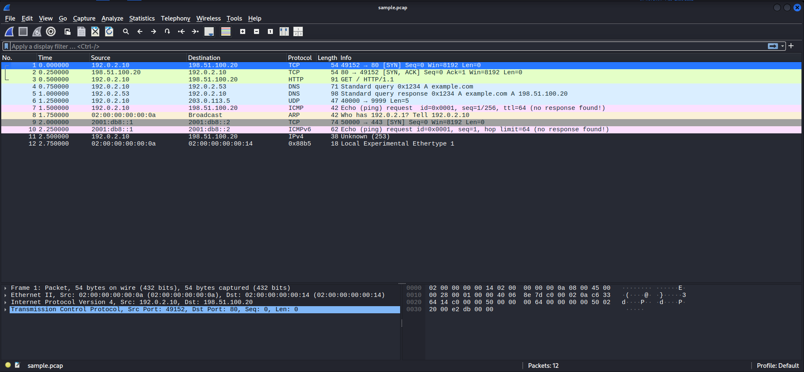

# REPORT

# PacketIQ AI: Week 1 Report, Packet Capture & Protocol Parsing

**Intern:** Nadji Houa
**Program:** AeroVerix Security, AI & Software Development Internship
**Assigned:** 22 October 2026 · **Deadline:** 27 October 2026, 11:59 PM PKT

## 1-Objective

Build the foundation of PacketIQ AI: discover capture interfaces, read PCAP files offline, parse packets into standard metadata fields, and validate them with repeatable tests. Live capture is limited to authorized interfaces and is optional.

## 2-Deliverables

| Deliverable | Location |
| --- | --- |
| Project structure and dependencies | `backend/app`, `frontend/src`, `sample_pcaps`, `tests`, `requirements.txt` |
| Capture module | `backend/app/capture.py` |
| Sample PCAP (12 synthetic packets) | `sample_pcaps/sample.pcap`, generated by `scripts/make_sample_pcap.py` |
| Tests | `tests/test_capture.py` (31 tests) |
| Test and CLI output | `evidence/pytest_output.txt`, `evidence/cli_parse_output.txt`, plus Windows run below |
| Setup guide | `README.md` |

## 3-Environment

| Item | Value |
| --- | --- |
| Primary test machine | Windows 11 (PowerShell Python 3.12.3), Linux Python 3.12.3 |
| Python | 3.13.15 |
| pytest | 9.1.1 |
| Scapy | 2.8.0 |

## 4-Setup steps (Windows)

```powershell
python -m venv venv
.\venv\Scripts\Activate.ps1
pip install -r requirements.txt
python scripts\make_sample_pcap.py
pytest tests\test_capture.py -v
python -m backend.app.capture parse sample_pcaps\sample.pcap
```

`source venv/bin/activate` is the Linux/macOS equivalent. Command Prompt users run `venv\Scripts\activate.bat`.

## 5-Design decisions

1. **One flat record type (`PacketRecord`).** Every packet yields the same 13 fields. Absent values are `None`, so later code needs no per-protocol branching. A test checks that all records share the same keys.
2. **Protocol label priority:** DNS > TCP > UDP > ICMP > ICMPv6 > ARP > OTHER. DNS is labelled by its dissected layer even though it runs over UDP, and transport ports are still reported.
3. **`parse_packet()` never raises.** On an unexpected error it returns a record with `protocol = "OTHER"`, `length = 0`, and `parse_error` set, so one bad packet cannot stop a file.
4. **Missing layers are handled explicitly.** ARP and raw Ethernet frames have no IP fields. ICMP and ICMPv6 have no ports or TCP flags. IPv4 with an unrecognised protocol number is `OTHER` but keeps its addresses.
5. **Length** is the on-wire length when available, otherwise the captured length.
6. **DNS query** is the first question name, decoded and without the trailing dot. DNS responses repeat the question, so they carry it too.
7. **Streaming reader.** `iter_pcap()` reads packets one at a time. `read_pcap()` returns a list. Missing or invalid files raise `PcapReadError`.
8. **Guarded live capture.** `capture_live()` refuses to run without `authorized=True` (CLI flag `--i-am-authorized`) and is capped at 1000 packets and 60 seconds. Permission and interface errors become `CaptureError`.
9. **Synthetic sample data.** The sample uses RFC 5737 and RFC 3849 documentation addresses and `example.com`. It is deterministic (fixed timestamps). SHA-256: `9613451f3d7ee94c9972f720805327752412540d96ea03ede659280110b9b119`.
10. **Secrets handling.** `.gitignore` excludes `.env`, `venv/`, and PCAP files except the synthetic sample. `.env.example` contains placeholders only. A scan found no keys or passwords.

## 6-Results

### Test run (Windows, Python 3.13.15)

```powershell
 > pytest tests/test_capture.py -v
================================================= test session starts =================================================
platform win32 -- Python 3.13.15, pytest-9.1.1, pluggy-1.7.0 -- <REDACTED>\venv\Scripts\python.exe
cachedir: .pytest_cache
rootdir: <REDACTED>
configfile: pytest.ini
plugins: anyio-4.15.1
collected 31 items

tests/test_capture.py::test_sample_parses_without_errors PASSED                                                  [  3%]
tests/test_capture.py::test_every_record_has_identical_keys PASSED                                               [  6%]
tests/test_capture.py::test_timestamps_are_ordered_and_iso PASSED                                                [  9%]
tests/test_capture.py::test_tcp_syn_fields PASSED                                                                [ 12%]
tests/test_capture.py::test_tcp_flag_strings PASSED                                                              [ 16%]
tests/test_capture.py::test_packet_lengths PASSED                                                                [ 19%]
tests/test_capture.py::test_dns_query_extracted PASSED                                                           [ 22%]
tests/test_capture.py::test_dns_response_keeps_question_name PASSED                                              [ 25%]
tests/test_capture.py::test_plain_udp PASSED                                                                     [ 29%]
tests/test_capture.py::test_icmp_has_no_ports PASSED                                                             [ 32%]
tests/test_capture.py::test_ipv6_tcp PASSED                                                                      [ 35%]
tests/test_capture.py::test_icmpv6 PASSED                                                                        [ 38%]
tests/test_capture.py::test_arp_is_non_ip PASSED                                                                 [ 41%]
tests/test_capture.py::test_ip_without_known_transport PASSED                                                    [ 45%]
tests/test_capture.py::test_ethernet_frame_without_ip PASSED                                                     [ 48%]
tests/test_capture.py::test_truncated_tcp_does_not_raise PASSED                                                  [ 51%]
tests/test_capture.py::test_bare_payload_without_any_layer PASSED                                                [ 54%]
tests/test_capture.py::test_parse_packet_never_raises_on_bad_object PASSED                                       [ 58%]
tests/test_capture.py::test_hand_built_arp_packet PASSED                                                         [ 61%]
tests/test_capture.py::test_missing_file_raises PASSED                                                           [ 64%]
tests/test_capture.py::test_non_pcap_file_raises PASSED                                                          [ 67%]
tests/test_capture.py::test_empty_pcap_returns_empty_list PASSED                                                 [ 70%]
tests/test_capture.py::test_limit_argument PASSED                                                                [ 74%]
tests/test_capture.py::test_list_interfaces_shape PASSED                                                         [ 77%]
tests/test_capture.py::test_live_capture_requires_authorization PASSED                                           [ 80%]
tests/test_capture.py::test_live_capture_enforces_limits[0-5] PASSED                                             [ 83%]
tests/test_capture.py::test_live_capture_enforces_limits[5000-5] PASSED                                          [ 87%]
tests/test_capture.py::test_live_capture_enforces_limits[5-0] PASSED                                             [ 90%]
tests/test_capture.py::test_live_capture_enforces_limits[5-600] PASSED                                           [ 93%]
tests/test_capture.py::test_live_capture_bad_interface_gives_capture_error PASSED                                [ 96%]
tests/test_capture.py::test_live_capture_short_authorized SKIPPED (live capture is opt-in: set PACKETIQ_LIVE...) [100%]

============================================ 30 passed, 1 skipped in 0.50s ============================================
```

The skipped test is the opt-in live capture, which runs only with `PACKETIQ_LIVE_TEST=1` and `PACKETIQ_LIVE_IFACE` set.

### Offline parse of `sample.pcap` (Windows & Linux)

```bash
$ python -m backend.app.capture parse sample_pcaps/sample.pcap
 
  # proto    len src                          dst                          flags dns
------------------------------------------------------------------------------------
  0 TCP       54 192.0.2.10:49152             198.51.100.20:80             S     -
  1 TCP       54 198.51.100.20:80             192.0.2.10:49152             SA    -
  2 TCP       91 192.0.2.10:49152             198.51.100.20:80             PA    -
  3 DNS       71 192.0.2.10:53000             192.0.2.53:53                -     example.com
  4 DNS       98 192.0.2.53:53                192.0.2.10:53000             -     example.com
  5 UDP       47 192.0.2.10:40000             203.0.113.5:9999             -     -
  6 ICMP      42 192.0.2.10                   198.51.100.20                -     -
  7 ARP       42 -                            -                            -     -
  8 TCP       74 2001:db8::1:50000            2001:db8::2:443              S     -
  9 ICMPv6    62 2001:db8::1                  2001:db8::2                  -     -
 10 OTHER     38 192.0.2.10                   198.51.100.20                -     -
 11 OTHER     18 -                            -                            -     -

12 packet(s)
```

Or in Wireshark :



### Coverage

Tests check IP addresses, ports, protocol labels, TCP flags, packet lengths, DNS query and response, IPv6, ICMPv6, ARP, IP without a transport layer, Ethernet without IP, truncated TCP, non-Scapy input, missing, invalid, and empty files, the `limit` argument, interface listing, and live-capture guards.

## 7-Bug found and fixed

`test_live_capture_bad_interface_gives_capture_error` failed on the first run. Scapy raises `ValueError` for an unknown interface, and `capture_live()` did not convert it. The fix adds `ValueError` to the exceptions converted to `CaptureError`. All tests pass after the fix.

## 8-Known issues and limitations

- **No libpcap on this Windows machine.** Scapy printed “No libpcap provider available! pcap won’t be used.” Offline PCAP reading still works because Scapy uses its own reader. Live capture needs Npcap.
- **Live capture was not tested on real traffic.** The sandbox run returned 0 packets from loopback. The live test is skipped by default.
- **Synthetic sample only.** Real captures may include IP fragments, IPv6 extension headers, VLAN tags, or tunnels, which this sample does not cover.
- **PCAPNG** is handled by Scapy’s reader but was not tested with a PCAPNG file.
- **DNS:** only the first question is reported.
- **Protocol labels** come from dissected layers, not port guessing. DNS or HTTP on non-standard ports appears as UDP or TCP.
- **Tested on Windows and Linux only.** macOS was not tested.
- **Screenshots:** the terminal output above is saved as text in `evidence/`. Attach screenshots from your machine as well.

## 9-Conclusion

The Week 1 foundation works: offline PCAP parsing completes without errors, supported packets produce the expected metadata and protocol labels, absent fields are handled consistently, the tests run and pass, and the live-capture guard is in place. Secrets are excluded from the repository.